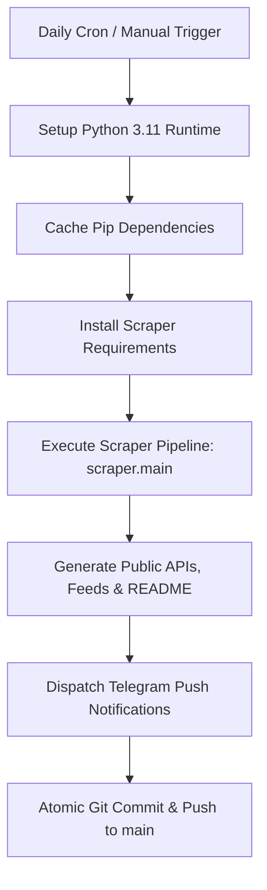

# ⚙️ GitHub Actions Workflows (`.github/workflows/`)

This directory contains the automated CI/CD workflows and scheduled background pipelines that power InternScan.

---

## 1. Workflows Map

| Workflow File | Trigger | Purpose |
|---|---|---|
| [`update.yml`](update.yml) | Scheduled (`cron: "0 21 * * *"`) & Manual (`workflow_dispatch`) | Runs daily at 03:00 AM IST (21:30 UTC), executes `scraper.main`, syncs `data/jobs.json`, regenerates public APIs, feeds, and markdown documents, and commits changes. |
| [`scraper-doctor.yml`](scraper-doctor.yml) | Scheduled & Manual | Nightly diagnostic runner that checks adapter health across all tracked companies and flags broken career endpoints. |

---

## 2. Secrets & Configuration

The automated workflows leverage the following optional GitHub Repository Secrets:

- `TELEGRAM_BOT_TOKEN`: The bot API token provided by `@BotFather` for automated notification dispatch.
- `TELEGRAM_CHAT_ID`: The channel ID or group chat ID where new internship alerts are broadcast.
- `SERP_API_KEY` / `RAPIDAPI_KEY`: Optional fallback keys used for Google Jobs SERP fallback when ATS endpoints are blocked.

---

## 3. Workflow Execution Flow

