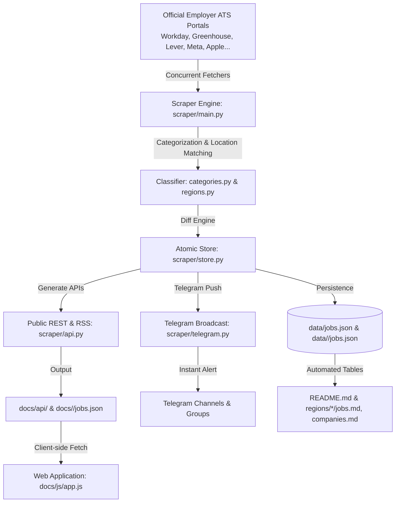

# 🏛️ InternScan System Architecture

This document describes the high-level architecture, synchronization pipelines, and data models that power **InternScan**.

---

## 1. High-Level System Overview

---

## 2. Core Architectural Pillars

### A. Non-Destructive State Synchronization

- **Problem:** Many job tracking boards wipe and recreate their database during each scrape. If a company temporarily hides a job or their career portal experiences a momentary glitch, records flicker on and off, losing historical tracking.
- **Solution:** In InternScan, **jobs are never deleted**. When an active job disappears from an employer's ATS feed, it is marked `active: false` and timestamped with `closed = today`. If the job reappears later, it is marked `reopened = today`, while retaining its original `first_seen` date.

### B. POSIX Atomic File Commitments

- Master databases (`data/jobs.json`, `docs/jobs.json`), API artifacts (`docs/api/*.json`), and generated Markdown files (`README.md`, `regions/*/*.md`) write first to a temporary file (`.tmp`).
- Commits use `os.replace` (POSIX atomic rename). If a cloud node crashes, runs out of disk space, or is terminated mid-write, database corruption is physically impossible.

### C. Extreme Memory Efficiency (< 35 MB Budget)

- Designed to run on micro cloud servers (such as ₹10/mo 256 MB VPS nodes or free-tier GitHub Actions runners).
- **Heavy web drivers (Selenium, Playwright) and bulky data science libraries (Pandas, NumPy) are strictly prohibited.**
- Operations rely on Python's optimized standard library (`urllib`, `json`, `concurrent.futures`, `re`) and lightweight HTTP libraries.

---

## 3. Data Model & Identifiers

Every listing is represented by the immutable `Job` dataclass ([`scraper/models.py`](scraper/models.py)):

| Field | Type | Description |
| :--- | :--- | :--- |
| `uid` | `str` | Stable primary key: `{company_slug}:{external_id}` (e.g. `nvidia:JR198231`) |
| `company` | `str` | Display company name (e.g. `"NVIDIA"`) |
| `external_id` | `str` | Employer's official requisition or posting ID |
| `title` | `str` | Clean engineering role title |
| `url` | `str` | Direct apply or careers portal link |
| `locations` | `List[str]` | Normalized list of locations |
| `country` | `str` | ISO country code (`in`, `us`, `ca`, `uk`, `eu`) |
| `region` | `str` | Geopolitical bucket (`APAC`, `AMER`, `EMEA`) |
| `city_tag` | `str` | Recognized tech hub (e.g. `Bengaluru`, `SF Bay Area`, `Toronto`, `London`) |
| `category` | `str` | Engineering domain (`Software`, `AI/ML`, `Data`, `Silicon`, `Security`...) |
| `posted` | `str` | Official date published by employer (`YYYY-MM-DD`) |
| `first_seen` | `str` | Date first discovered by InternScan (`YYYY-MM-DD`) |
| `last_seen` | `str` | Date most recently verified active (`YYYY-MM-DD`) |
| `active` | `bool` | Current listing status |

---

## 4. Multi-Region Routing Architecture

InternScan supports modular country routing across 5 major technical job markets:

1. **`in` (India):** Bengaluru, Hyderabad, Pune, Delhi-NCR, Chennai, Mumbai.
2. **`us` (United States):** SF Bay Area, Seattle, New York, Austin, Boston.
3. **`ca` (Canada):** Toronto, Waterloo, Vancouver, Montreal.
4. **`uk` (United Kingdom):** London, Cambridge / Oxford, Manchester, Edinburgh.
5. **`eu` (Europe):** Berlin, Munich, Dublin, Amsterdam, Zurich, Paris.

The web frontend (`docs/index.html`) provides automatic, zero-permission timezone/locale detection that smoothly redirects incoming visitors to their regional tracker, while honoring explicit user preferences (`?noredirect=1`).
