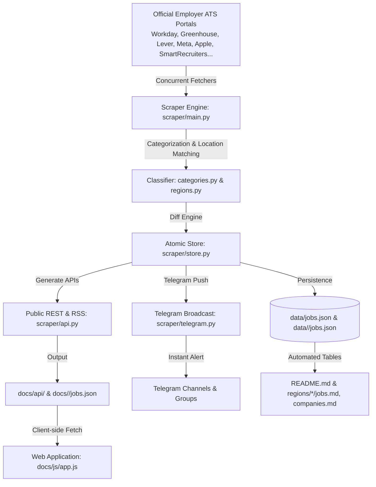

# 🏛️ InternScan System Architecture

This document describes the high-level architecture, synchronization pipelines, data models, and location resolution engines that power **InternScan**.

---

## 1. High-Level System Overview

---

## 2. Core Architectural Pillars

### A. Non-Destructive State Synchronization
- **Problem:** Many job tracking boards wipe and recreate their database during each scrape. If a company temporarily hides a job or their career portal experiences a momentary glitch, records flicker on and off, losing historical tracking.
- **Solution:** In InternScan, **jobs are never deleted**. When an active job disappears from an employer's ATS feed, it is marked `active: false` and timestamped with `closed = today`. If the job reappears later, it is marked `reopened = today`, while retaining its original `first_seen` date.

### B. POSIX Atomic File Commitments
- Master databases (`data/jobs.json`, `docs/jobs.json`), regional slices (`data/<country>/jobs.json`), API artifacts (`docs/api/*.json`), and generated Markdown files (`README.md`, `regions/*/*.md`) write first to a temporary file (`.tmp`).
- Commits use `os.replace` (POSIX atomic rename). If a cloud node crashes, runs out of disk space, or is terminated mid-write, database corruption is physically impossible.

### C. Extreme Memory Efficiency (< 35 MB Budget)
- Designed to run on micro cloud servers (such as ₹10/mo 256 MB VPS nodes or free-tier GitHub Actions runners).
- **Heavy web drivers (Selenium, Playwright) and bulky data science libraries (Pandas, NumPy) are strictly prohibited.**
- Operations rely on Python's optimized standard library (`urllib`, `json`, `concurrent.futures`, `re`) and lightweight HTTP clients.

---

## 3. Data Model & Identifiers

Every listing is represented by the immutable `Job` dataclass ([`scraper/models.py`](scraper/models.py)):

| Field | Type | Description |
| :--- | :--- | :--- |
| `uid` | `str` | Stable primary key: `{company_slug}:{external_id}` (e.g. `nvidia:JR198231`) |
| `company` | `str` | Display company name (e.g. `"NVIDIA"`) |
| `external_id` | `str` | Employer's official requisition or posting ID |
| `title` | `str` | Clean engineering role title |
| `url` | `str` | Direct apply or careers portal link |
| `locations` | `List[str]` | Normalized list of locations from ATS |
| `country` | `str` | ISO country code (`in`, `us`, `ca`, `uk`, `eu`) |
| `region` | `str` | Geopolitical bucket (`APAC`, `AMER`, `EMEA`, `Remote`) |
| `city_tag` | `str` | Recognized tech hub filter (e.g. `Bengaluru`, `SF Bay Area`, `Toronto`, `London`, `Remote`) |
| `category` | `str` | Engineering domain (`Software`, `AI/ML`, `Data`, `Silicon`, `Security`...) |
| `posted` | `str` | Official date published by employer (`YYYY-MM-DD`) |
| `first_seen` | `str` | Date first discovered by InternScan (`YYYY-MM-DD`) |
| `last_seen` | `str` | Date most recently verified active (`YYYY-MM-DD`) |
| `active` | `bool` | Current listing status (`true` / `false`) |

---

## 4. Multi-Region Routing Architecture

InternScan supports modular country routing across 5 major technical job markets:

1. **`in` (India):** Bengaluru, Hyderabad, Pune, Delhi-NCR, Chennai, Mumbai.
2. **`us` (United States):** SF Bay Area, Seattle, New York, Austin, Boston.
3. **`ca` (Canada):** Toronto, Waterloo, Vancouver, Montreal, Ottawa.
4. **`uk` (United Kingdom):** London, Cambridge / Oxford, Manchester, Edinburgh.
5. **`eu` (Europe):** Berlin, Munich, Dublin, Amsterdam, Zurich, Paris, Stockholm.

The web frontend (`docs/index.html`) provides automatic, zero-permission timezone/locale detection that smoothly directs incoming visitors to their regional tracker, while honoring explicit user preferences (`?noredirect=1`).

---

## 5. Location Extraction & Place-Level Normalization

To eliminate opaque or unhelpful tags on job cards, InternScan implements a two-tier location resolution pipeline across both backend markdown generators and the frontend client:

1. **Specific Place Resolution (`resolveDisplayPlace` / `_extract_display_place`):**
   - Extracts exact city names and state/province/country codes (e.g., `"Santa Clara, CA"`, `"Seattle, WA"`, `"Toronto, ON"`, `"Vancouver, BC"`, `"Cambridge, UK"`, `"Munich, Germany"`).
   - Strips redundant postal codes, building identifiers, and raw coordinates.
   - Cleans national fallbacks (e.g. mapping `"United States"` or `"US"` to clean `"United States"` instead of raw internal codes).

2. **Tech Hub Categorization (`city_tag`):**
   - Clusters granular place locations into high-level filterable hubs (`SF Bay Area`, `Seattle`, `Delhi-NCR`, `Bengaluru`, `London`, `Berlin`, `Toronto`).
   - Enables fast facet filtering in the UI while preserving the exact office location badge on the individual job card.

---

## 6. Public REST & RSS APIs (CORS-Enabled)

The API generator (`scraper/api.py`) outputs static REST JSON payloads and RSS 2.0 feeds on every scrape:

- **`/api/active.json`**: Complete listing of all currently active verified internships worldwide.
- **`/api/latest.json`**: New and reopened internships discovered in the most recent scrape cycle.
- **`/{region}/api/active.json`**: Regional partitions (`in`, `us`, `ca`, `uk`, `eu`).
- **`/feed.xml`**: Standard RSS 2.0 feed with RFC-822 timestamps and GUIDs for automated bots, Discord/Slack webhooks, and RSS readers.
- **`/metrics.json`**: Scraper health metrics, total active roles, regional breakdowns, and execution timings.

All endpoints are hosted statically on GitHub Pages / Vercel with zero rate limits, no authentication requirements, and open `Access-Control-Allow-Origin: *` headers.

---

## 7. Ultra-Lightweight Telegram Bot (`bot/`)

The Telegram bot (`bot/main.py`) runs 24/7 with a memory footprint under **35 MB RAM**:
- **Daemon Mode:** Uses long-polling via standard library HTTP without heavy framework overhead.
- **Broadcast Pipeline:** Can be triggered post-scrape to broadcast rich HTML cards to Telegram channels.
- **Interactive Commands:** Supports `/latest`, `/active`, `/status`, and `/help`.
- **Systemd Service:** Ships with a production systemd unit (`bot/internscan-bot.service`) with auto-restart on failure.

---

## 8. Frontend Architecture & Design System

The frontend in `docs/` is built entirely with **Vanilla HTML, CSS, and JavaScript**:
- **Design System:** Root CSS custom properties (`--brand`, `--bg`, `--surface`, `--ink`, `--line`) in `docs/css/style.css` supporting dark/light mode with zero flash of unstyled content.
- **Fuzzy Search & Filtering:** Client-side multi-facet pipeline in `docs/js/app.js` filtering across search query, tech hub, engineering category, country, and status in < 5ms.
- **Zero Heavy Bundlers:** No webpack, no vite, no external npm packages. Ultra-fast initial page loads (< 100ms) and low bandwidth consumption.
